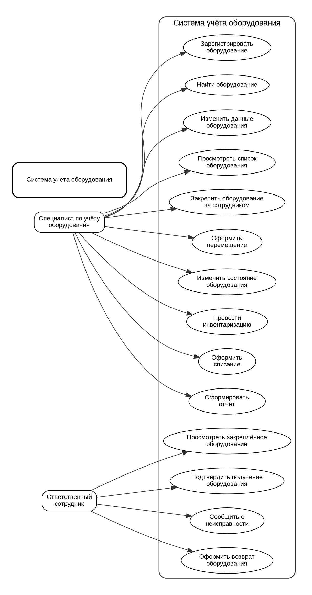

# Учёт оборудования в организации

## Описание

Учебный проект информационной системы для **учёта оборудования в организации**.
Система предназначена для хранения сведений об оборудовании, его расположении и ответственных сотрудниках.

## Пользователи

- **Специалист по учёту оборудования** — работает с оборудованием, выполняет поиск, инвентаризацию и оформляет перемещения.
- **Ответственный сотрудник** — просматривает закреплённое оборудование, подтверждает получение и сообщает о неисправностях.

## Основные функции

| Функция | Назначение |
|---|---|
| Регистрация | Добавление нового оборудования |
| Поиск | Поиск по инвентарному или серийному номеру |
| Перемещение | Оформление перемещения оборудования |
| Инвентаризация | Проверка наличия оборудования |
| Отчёты | Формирование отчётов по оборудованию |

## Запуск

Для запуска программы выполните:

```bash
python src/main.py
```

Результат работы программы:

```text
Система учёта оборудования
Лабораторная работа №2
```

## Диаграмма вариантов использования



Исходный файл диаграммы находится в [use_case.puml](docs/diagrams/use_case.puml).

## Используемые технологии

- Python
- Git
- GitHub
- Markdown
- PlantUML

Дополнительная информация: [GitHub](https://github.com/).

## Автор

Живаев Александр

## Лабораторная работа № 3

### Учёт оборудования в организации

В этой работе была создана база данных для учёта оборудования в организации. Она позволяет хранить информацию об оборудовании, сотрудниках, подразделениях, перемещениях и ремонте.

### Структура базы данных

В базе данных есть пять таблиц:

- `departments` — хранит информацию о подразделениях организации.
- `employees` — содержит данные о сотрудниках.
- `equipment` — хранит информацию об оборудовании: название, инвентарный номер, стоимость, состояние и ответственного сотрудника.
- `movements` — хранит историю перемещений оборудования между подразделениями.
- `repairs` — содержит информацию о неисправностях и ремонте.

Таблицы связаны между собой с помощью первичных и внешних ключей. Благодаря этому можно узнать, за кем закреплено оборудование, где оно находится и какие операции с ним проводились.

### ER-диаграмма

На диаграмме показаны таблицы базы данных и связи между ними.


### Запуск программы

Для создания базы данных используется файл `init_db.py`, а структура таблиц и тестовые данные находятся в `schema.sql`.

Чтобы создать базу данных, нужно открыть терминал в папке проекта и выполнить команду:

```bash
python init_db.py
```

После запуска будет создан файл `equipment.db` с таблицами и тестовыми записями.
